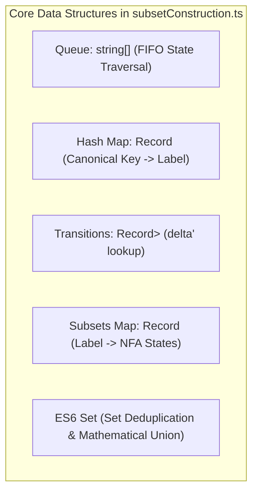
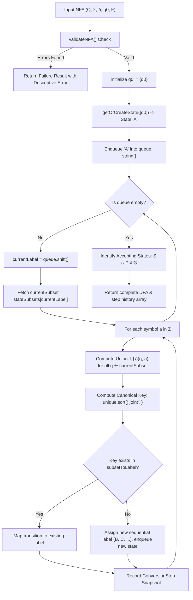

# Technical Report: Code Architecture, Data Structures, and Internal Implementation Mechanics

**Project Title:** Interactive NFA to DFA Conversion Simulator using Subset Construction Algorithm  
**Core Technologies:** React 19, TypeScript 5.8, Tailwind CSS, React Flow (@xyflow/react), Vitest  
**Document Classification:** Academic Viva Preparation & Software Engineering Defense Report  

---

## 1. Executive Summary

This report provides an in-depth technical examination of the codebase implementing the **Subset Construction Algorithm (Powerset Construction)**. It details:
1. Why dynamic memory structures and hash tables are used instead of fixed-size arrays.
2. The theoretical maximum array bounds ($2^{|Q|}$) versus actual reachable state space allocation.
3. The end-to-end procedural execution flow across core modules.
4. Formal algorithmic complexity proofs.
5. Curated technical questions and answers designed for university project viva defense.

---

## 2. Data Structure Architecture & Selection Rationale

### 2.1 The "Array Size" Question: Theoretical vs. Practical Memory Allocation

| Dimension | Theoretical Automata Theory | Our TypeScript Implementation |
| :--- | :--- | :--- |
| **Max States** | $|\mathcal{P}(Q)| = 2^{|Q|}$ (Exponential Power Set) | Dynamically allocated array `string[]` |
| **Memory Allocation** | Static upper-bound reservation ($2^n$ rows) | On-demand dynamic heap allocation ($|Q_{reachable}|$) |
| **3-State NFA Example** | Theoretical max = $2^3 = 8$ states | Exact allocated states = **4 states** (`A, B, C, D`) |
| **Dead/Trap State** | Explicit empty set state $\emptyset$ | Single singleton node `'∅'` created only if reached |

#### Why Fixed Arrays Are NOT Used
In languages like C or Java, developers often allocate fixed matrices such as `int transitions[100][100]`. In modern high-level TypeScript/JavaScript running on the V8 engine:
1. **Dynamic Expansion:** Arrays (`string[]`) begin at zero length and grow amortized $O(1)$ via dynamic reallocation.
2. **Sparsity Optimization:** The full powerset $2^n$ is rarely reachable from the start state $q_0$. Allocating $2^n$ entries in advance would incur unnecessary $O(2^n)$ spatial waste.
3. **Safety Bounds:** For a typical educational NFA with $n \le 10$, $2^{10} = 1024$ subsets is easily handled within memory limits without stack overflow.

---

### 2.2 Core Data Structures Comparison



1. **`Record<string, Record<string, string>>` (Nested Hash Map):**
   - Replaces a 2D integer matrix `table[i][j]`.
   - Allows direct string-keyed lookups: `dfaTransitions['A']['0'] => 'B'` in $O(1)$ expected time.
   - Eliminates fragile index mapping (`0 => q0`, `1 => q1`).

2. **`Set<string>`:**
   - Used in `computeSubsetTransition` to compute $\bigcup_{q \in S} \delta(q, a)$.
   - Guarantees uniqueness in $O(1)$ insertion time, preventing duplicate states in subset arrays.

3. **`string[]` as FIFO Queue:**
   - Tracks unexpanded DFA states (`queue.shift()` for dequeue, `queue.push()` for enqueue).
   - Guarantees standard Breadth-First Search (BFS) discovery order.

---

## 3. How the Code Works Internally (Procedural Flow)

The core conversion logic is encapsulated in [`src/core/subsetConstruction.ts`](file:///Users/divakarmaurya/automata/src/core/subsetConstruction.ts). Below is the precise 6-stage operational pipeline:



---

### 3.1 Stage-by-Stage Breakdown

#### Stage 1: Input Validation (`validateNFA`)
Before running any conversions, the engine verifies:
- State list $Q \neq \emptyset$.
- Input alphabet $\Sigma \neq \emptyset$.
- Initial state $q_0 \in Q$.
- Final states $F \subseteq Q$.
- All transition symbols $\in \Sigma$ and destinations $\subseteq Q$.

#### Stage 2: Canonical Subset Keying (`getCanonicalSubsetKey`)
Because set elements have no natural order, $\{q_0, q_1\}$ and $\{q_1, q_0\}$ represent the exact same DFA state.
```typescript
export function getCanonicalSubsetKey(states: string[]): string {
  const unique = Array.from(new Set(states)).filter(Boolean);
  unique.sort(); // Lexicographical sorting guarantees deterministic key
  return unique.join(','); // Output: "q0,q1"
}
```
This string acts as an exact hash key in `subsetToLabel["q0,q1"]`.

#### Stage 3: Union Calculation (`computeSubsetTransition`)
For a current DFA state containing multiple NFA states $S = \{q_0, q_1\}$ on symbol `a`:
$$\delta_{DFA}(S, a) = \bigcup_{q \in S} \delta_{NFA}(q, a)$$
In TypeScript:
```typescript
const resultSet = new Set<string>();
for (const q of subset) {
  const destinations = getNFATransition(nfa, q, symbol);
  for (const dest of destinations) {
    resultSet.add(dest); // Set automatically discards duplicates
  }
}
const unionResult = Array.from(resultSet).sort();
```

#### Stage 4: Dead/Trap State Handling
If `unionResult.length === 0` (no transitions exist for that input symbol):
1. A dedicated dead state label `'∅'` is instantiated.
2. In the DFA, this state self-loops on every alphabet symbol:
   $$\delta'(\emptyset, a) = \emptyset \quad \forall a \in \Sigma$$
3. The dead state is non-accepting because $\emptyset \cap F = \emptyset$.

#### Stage 5: Final State Identification
A DFA state $S$ is accepting if and only if it contains **at least one** NFA accepting state:
```typescript
const isFinal = sortedSubset.some((s) => nfa.finalStates.includes(s));
if (isFinal) {
  dfaFinalStates.push(label);
}
```

#### Stage 6: Deterministic String Simulation (`simulateStringOnDFA`)
Located in [`src/core/stringSimulator.ts`](file:///Users/divakarmaurya/automata/src/core/stringSimulator.ts):
1. Begins at `currentState = dfa.initialState` (`'A'`).
2. Iterates over each character in the input string:
   ```typescript
   const nextState = dfa.transitions[currentState]?.[char];
   ```
3. Records each step for visual highlighting in the React Flow graph.
4. If character is not in $\Sigma$ or transitions to undefined $\implies$ Rejected.
5. Upon reaching the end of the string:
   $$\text{Result} = \begin{cases} \text{ACCEPTED} & \text{if } \text{currentState} \in F' \\ \text{REJECTED} & \text{otherwise} \end{cases}$$

---

## 4. Algorithmic Complexity Analysis

### 4.1 Time Complexity

Let:
- $|Q| = n$ (Number of NFA states)
- $|\Sigma| = m$ (Size of alphabet)
- $|Q'| = k \le 2^n$ (Number of reachable DFA states)

1. **Subset Transition:** For each reachable DFA state and each symbol, we iterate over at most $n$ NFA states:
   $$O(n \cdot m)$$
2. **Canonical Key Generation:** Sorting a subset of at most $n$ states takes:
   $$O(n \log n)$$
3. **Total Time:**
   $$T = O(k \cdot m \cdot n \log n)$$
   - In the **worst theoretical case** ($k = 2^n$): $O(m \cdot n 2^n \log n)$.
   - In the **average practical case** ($k \ll 2^n$): Typically $k \le 10$, executing in $< 2\text{ ms}$ in the browser.

### 4.2 Space Complexity
1. **State Subsets Map:** Stores at most $k$ subsets, each of size $\le n \implies O(k \cdot n)$.
2. **Transition Table:** Stores $k \times m$ transitions $\implies O(k \cdot m)$.
3. **BFS Queue:** Holds at most $k$ string labels $\implies O(k)$.
4. **Overall Space:** $O(k(n + m)) \subseteq O(2^n(n + m))$.

---

## 5. Top 15 Viva Questions & Model Answers

### Question 1: What is the maximum size of the DFA state array?
**Answer:** "Theoretically, the maximum size is $2^n$, where $n$ is the number of NFA states, because the DFA states represent subsets from the power set $\mathcal{P}(Q)$. Practically, our TypeScript array dynamically expands and only stores the reachable states from the initial state."

### Question 2: Why did you not use a fixed-size 2D array for transitions?
**Answer:** "A fixed 2D array requires knowing the maximum number of states in advance and using integer indices. Our application uses TypeScript `Record<string, Record<string, string>>` hash maps, which allow direct $O(1)$ key-based lookup using meaningful string state labels (like `'A'`, `'B'`) without memory waste."

### Question 3: How does your code guarantee that $\{q_0, q_1\}$ and $\{q_1, q_0\}$ are treated as the same state?
**Answer:** "We implemented the `getCanonicalSubsetKey()` function. It takes the array of state strings, removes duplicates using `new Set()`, sorts them alphabetically, and joins them with commas to form a unique canonical key `'q0,q1'`. This key is checked against the hash map `subsetToLabel` in $O(1)$ time."

### Question 4: How do you prevent an infinite loop in the `while (queue.length > 0)` loop?
**Answer:** "Before pushing any state into the queue, we check whether its canonical key already exists in the `subsetToLabel` map. Since the powerset is finite ($2^n$ possible subsets), each unique subset is enqueued exactly once. Therefore, the queue is guaranteed to become empty and terminate."

### Question 5: What happens when an NFA transition has no destination on an input symbol?
**Answer:** "The union returns an empty array `[]`. Our function `getOrCreateState([])` maps this to the canonical dead/trap state `'∅'`. The algorithm then adds self-loops on `'∅'` for every alphabet symbol ($\delta'(\emptyset, a) = \emptyset$)."

### Question 6: How are DFA final states determined in your code?
**Answer:** "During state creation, we check if the subset intersects with the NFA's final states set: `sortedSubset.some(s => nfa.finalStates.includes(s))`. If at least one state in the subset is an accepting NFA state, the entire DFA state is marked as final."

### Question 7: How does the string simulator validate strings?
**Answer:** "The function `simulateStringOnDFA` reads characters sequentially, starting from the DFA's initial state `'A'`. It follows transitions `currentState = dfa.transitions[currentState][char]`. If all characters are consumed and the resulting state is in `dfa.finalStates`, the string is ACCEPTED; otherwise, it is REJECTED."

### Question 8: Can your simulator handle the empty string ($\epsilon$)?
**Answer:** "Yes. For the empty string `""`, the simulator makes zero transition steps and immediately checks whether the initial state `'A'` is an accepting state. If `'A'` contains an NFA final state, $\epsilon$ is accepted; otherwise, rejected."

### Question 9: Why is the algorithm decoupled from the UI components?
**Answer:** "The core automata logic in `src/core/` consists of pure TypeScript functions without React hooks or JSX dependencies. This adheres to clean architecture principles, making the algorithm 100% testable via automated Vitest unit tests without needing a browser DOM."

### Question 10: How are step-by-step histories recorded for the stepper UI?
**Answer:** "Inside the conversion loop, at every symbol evaluation and state discovery, we create an immutable `ConversionStep` object containing a snapshot of the current subset, union formula, intermediate transition table, and queue state. The React UI simply renders these pre-computed snapshots with Previous/Next buttons."

### Question 11: What graph layout engine is used to position the nodes?
**Answer:** "We use `@xyflow/react` (React Flow) for interactive graph rendering and `@dagrejs/dagre` for automated directed acyclic graph layout. Dagre automatically calculates non-overlapping `x` and `y` coordinates for states."

### Question 12: How are invalid user inputs prevented?
**Answer:** "The `validateNFA()` function checks for empty state sets, missing initial states, invalid symbols, and transitions pointing to non-existent states before algorithm execution. If any errors are found, the UI blocks execution and displays inline error alerts."

### Question 13: What is the difference between `Record<string, Record<string, string[]>>` and `Record<string, Record<string, string>>`?
**Answer:** "The first is for the NFA, where a single state and symbol can transition to an array of multiple destination states (`string[]`). The second is for the DFA, where deterministic execution requires exactly one destination state (`string`)."

### Question 14: What is the time complexity of validating a string of length $L$?
**Answer:** "Because the DFA transition table provides $O(1)$ lookups per character, validating a string of length $L$ takes strictly linear time: $O(L)$."

### Question 15: What are the current limitations of this implementation?
**Answer:** "Currently, the simulator processes standard NFAs with alphabet symbols. Epsilon ($\epsilon$) transitions and post-conversion DFA minimization (Hopcroft's algorithm) are not included in the current version, though the modular architecture allows them to be added in future iterations."
