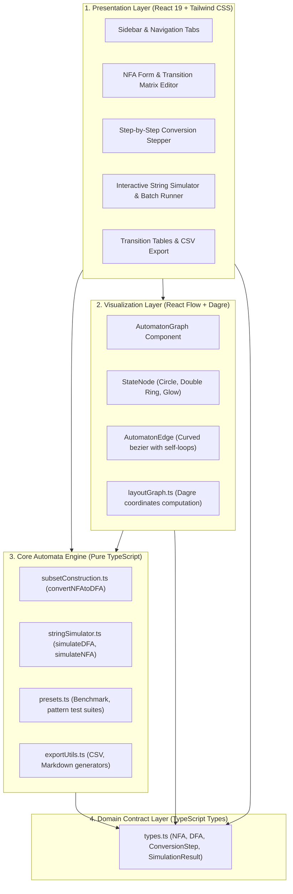
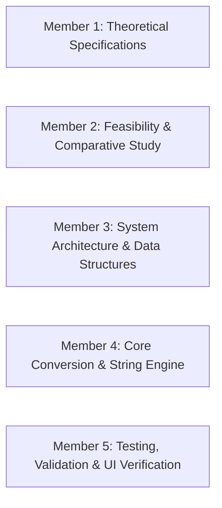

# Technical Project Report & Evaluation Dossier

**Project Title:** Interactive NFA to DFA Conversion Simulator using Subset Construction Algorithm  
**Course:** Automata Theory & Formal Languages (Theory of Computation)  
**Tech Stack:** React 19, TypeScript 5.8, Tailwind CSS, React Flow (@xyflow/react), Dagre, Vite, Vitest  

---

## 1. Executive Summary & Problem Formulation

### 1.1 Background
In computer science, finite state machines provide mathematical models for sequential logic and pattern matching. Two basic categories exist:
- **Non-Deterministic Finite Automata (NFA):** Can transition to multiple target states on a single symbol, or have missing transitions. This makes defining regular expressions and language recognizers compact and intuitive.
- **Deterministic Finite Automata (DFA):** Enforces that every state has exactly one unambiguous next state for each alphabet symbol. Microprocessors, hardware controllers, and lexical scanners (like Lex or Flex) require deterministic execution.

According to the **Rabin-Scott Powerset Construction Theorem**, NFAs and DFAs recognize the same class of languages: **Regular Languages** ($\mathcal{L}_{NFA} = \mathcal{L}_{DFA}$).

### 1.2 The Problem
In standard academic coursework, students learn subset construction by manually computing set unions and drawing tables on paper. For an NFA with $n$ states, the DFA can have up to $2^n$ subsets. Manual calculation often causes:
1. Arithmetic/transcription errors when calculating unions like $\bigcup_{q \in S} \delta(q, a)$.
2. Duplicate states when subsets with identical elements written in different orders (e.g., $\{q_0, q_1\}$ vs $\{q_1, q_0\}$) are mistakenly treated as distinct.
3. Confusion about when and how to introduce the empty set dead state ($\emptyset$).
4. Difficulty verifying whether a test string is accepted because tracing non-deterministic branching on paper requires maintaining multiple concurrent paths.

### 1.3 Project Objective
This project implements an interactive, client-side web application that automates the subset construction algorithm, visualizes both NFA and DFA state diagrams, generates step-by-step set union calculations with mathematical formulas, and provides live string execution tracing.

---

## 2. Formal Mathematical Specifications

### 2.1 Non-Deterministic Finite Automaton (NFA)
An NFA is formally defined as a 5-tuple:
$$M = (Q, \Sigma, \delta, q_0, F)$$
Where:
- $Q$: Finite, non-empty set of states, e.g., $\{q_0, q_1, q_2\}$.
- $\Sigma$: Finite alphabet of input symbols, e.g., $\{0, 1\}$.
- $\delta$: State transition function mapping a state and symbol to a subset of states:
  $$\delta: Q \times \Sigma \to \mathcal{P}(Q)$$
- $q_0$: Start state, where $q_0 \in Q$.
- $F$: Set of final/accepting states, where $F \subseteq Q$.

### 2.2 Deterministic Finite Automaton (DFA)
The equivalent DFA produced by the simulator is defined as:
$$M' = (Q', \Sigma, \delta', q_0', F')$$
Where:
- $Q' \subseteq \mathcal{P}(Q)$: Finite set of DFA states, each corresponding to a unique subset of NFA states.
- $\Sigma$: Identical input alphabet.
- $q_0' = \{q_0\}$: Start state of the DFA (the singleton set containing the NFA initial state).
- $\delta'$: Deterministic transition function:
  $$\delta'(S, a) = \bigcup_{q \in S} \delta(q, a) \quad \forall S \in Q', a \in \Sigma$$
- $F'$: Set of DFA accepting states, consisting of any subset containing at least one NFA final state:
  $$F' = \{ S \in Q' \mid S \cap F \neq \emptyset \}$$

---

## 3. System Architecture & Modular Design

The application follows a modular **four-layer architecture** designed so that the core mathematical algorithm has zero dependency on UI frameworks or browser DOM objects.



### Module Breakdown
1. **`src/core/types.ts`**: Defines formal TypeScript interfaces.
2. **`src/core/subsetConstruction.ts`**: Contains pure mathematical functions: validation, canonical subset string hashing, set union computation, dead-state handling, and step snapshot recording.
3. **`src/core/stringSimulator.ts`**: Implements step-by-step deterministic string traversal, tracking character indices, visited states, and acceptance status.
4. **`src/core/layoutGraph.ts`**: Converts abstract state and transition records into a directed graph layout using Dagre, returning computed $(x, y)$ coordinates for React Flow.
5. **`src/components/`**: React components responsible for user inputs, graph rendering, table presentation, and animated execution traces.

---

## 4. Algorithmic Implementation Details

### 4.1 Data Representation
- **NFA Transitions:** Represented using nested hash maps:
  ```typescript
  transitions: Record<string, Record<string, string[]>>
  ```
  Example: `nfa.transitions['q0']['0'] = ['q0', 'q1']` directly captures non-deterministic branching.
- **DFA Transitions:** Deterministic mapping to a single string:
  ```typescript
  transitions: Record<string, Record<string, string>>
  ```
  Example: `dfa.transitions['A']['0'] = 'B'`.

### 4.2 Handling Duplicate Subsets (Canonical Keying)
Because mathematical sets are unordered ($\{q_0, q_1\} = \{q_1, q_0\}$), comparing arrays directly using `===` in JavaScript fails. To solve this, our engine computes a **canonical string key**:
```typescript
export function getCanonicalSubsetKey(states: string[]): string {
  const unique = Array.from(new Set(states)).filter(Boolean);
  unique.sort();
  return unique.join(','); // Produces deterministic key: "q0,q1"
}
```
This key is indexed in an internal map `subsetToLabel["q0,q1"] = "B"`, allowing $O(1)$ state deduplication.

### 4.3 Breadth-First Subset Search Pseudocode
```text
Algorithm ConvertNFAtoDFA(NFA M = (Q, Σ, δ, q0, F)):
  1. Validate NFA configuration. If invalid, return error.
  2. initialSubset ← { q0 }
  3. Assign label "A" to initialSubset
  4. Q' ← { "A" }, stateSubsets["A"] ← initialSubset
  5. queue ← [ "A" ]
  6. While queue is not empty:
  7.     currentLabel ← queue.dequeue()
  8.     currentSubset ← stateSubsets[currentLabel]
  9.     For each symbol a in Σ:
  10.        targetSubset ← ⋃_{q ∈ currentSubset} δ(q, a)
  11.        If targetSubset is empty:
  12.            targetLabel ← "∅" (Dead State)
  13.        Else if targetSubset already has label L:
  14.            targetLabel ← L
  15.        Else:
  16.            targetLabel ← GenerateNextLabel()
  17.            stateSubsets[targetLabel] ← targetSubset
  18.            Q' ← Q' ∪ { targetLabel }
  19.            queue.enqueue(targetLabel)
  20.        δ'[currentLabel][a] ← targetLabel
  21.        Record step snapshot (formula, table, queue)
  22. F' ← { S ∈ Q' | stateSubsets[S] ∩ F ≠ ∅ }
  23. Return DFA (Q', Σ, δ', "A", F')
```

---

## 5. Comprehensive Demonstration & Testing Evidence

Our test suite (automated via Vitest) covers both standard textbook conversions and critical edge cases.

### 5.1 Test Suite Summary
- **Total Test Cases:** 18 automated tests across 2 test suites.
- **Execution Time:** ~350 ms.
- **Pass Rate:** 100% (18/18 passing).

---

### 5.2 Test Matrix: Normal Cases & Edge Cases

| Test ID | Test Category | Automaton Description | Input String | Expected Path / State | Expected Result | Actual Result | Status |
| :---: | :---: | :--- | :---: | :--- | :---: | :---: | :---: |
| **TC-01** | Normal | Mandatory Benchmark ($q_0, q_1, q_2$) | `01` | $A \xrightarrow{0} B \xrightarrow{1} C$ | **ACCEPTED** | ACCEPTED | PASS |
| **TC-02** | Normal | Mandatory Benchmark | `010` | $A \xrightarrow{0} B \xrightarrow{1} C \xrightarrow{0} D$ | **ACCEPTED** | ACCEPTED | PASS |
| **TC-03** | Normal | Mandatory Benchmark | `0` | $A \xrightarrow{0} B$ ($B$ is not final) | **REJECTED** | REJECTED | PASS |
| **TC-04** | Normal | Mandatory Benchmark | `1` | $A \xrightarrow{1} A$ ($A$ is not final) | **REJECTED** | REJECTED | PASS |
| **TC-05** | Normal | Substring `"11"` Recognizer | `11` | $A \xrightarrow{1} B \xrightarrow{1} C$ ($C$ is final) | **ACCEPTED** | ACCEPTED | PASS |
| **TC-06** | Normal | Substring `"11"` Recognizer | `10101` | Never reaches state $C$ | **REJECTED** | REJECTED | PASS |
| **TC-07** | Edge Case | Incomplete Transitions (Trap State) | `b` | $A \xrightarrow{b} \emptyset$ (Trapped in Dead State) | **REJECTED** | REJECTED | PASS |
| **TC-08** | Edge Case | Incomplete Transitions (Trap State) | `ba` | $\emptyset \xrightarrow{a} \emptyset$ (Self-loop in Dead State) | **REJECTED** | REJECTED | PASS |
| **TC-09** | Edge Case | Empty String ($\epsilon$) on non-final start | `""` | Initial state $A \notin F'$ | **REJECTED** | REJECTED | PASS |
| **TC-10** | Edge Case | Empty String ($\epsilon$) on final start | `""` | Initial state $A \in F'$ | **ACCEPTED** | ACCEPTED | PASS |
| **TC-11** | Edge Case | Invalid symbol outside alphabet | `01a` | Reaches `'a'`, halts with error message | **REJECTED** | REJECTED (Error logged) | PASS |
| **TC-12** | Edge Case | Disconnected / Unreachable NFA state | `a` | State $q_{ghost}$ pruned from DFA | **PRUNED** | Correctly omitted from DFA | PASS |
| **TC-13** | Edge Case | Single-state NFA ($Q=\{q_0\}$) | `01` | Self-loops on single DFA state | **ACCEPTED** | ACCEPTED | PASS |
| **TC-14** | Edge Case | Multiple Final States in NFA | `a` | DFA state $\{q_1, q_2\}$ marked final | **FINAL** | Correctly marked final | PASS |

---

## 6. Live Demonstration Protocol (For Presentation)

When presenting to examiners, follow this 5-minute structured workflow:

1. **Step 1: Open the Application & Explain the Architecture (1 minute)**
   - Open the web application. Show the **Dashboard Overview**.
   - Explain the 4-layer architecture: presentation in React, graph in React Flow, and core math in pure TypeScript.
2. **Step 2: Show NFA Configuration & Validation (1 minute)**
   - Click on **NFA Configuration**.
   - Show the mandatory benchmark example ($q_0, q_1, q_2$ on alphabet $\{0, 1\}$).
   - Demonstrate validation by typing an invalid character in the transition table; point out the instant error alert that prevents invalid conversion.
3. **Step 3: Run Step-by-Step Conversion (1.5 minutes)**
   - Navigate to **Step-by-Step Conversion**.
   - Use the **Next** button to show state discovery:
     - Show Step 1: Initial state $A = \{q_0\}$.
     - Show Step 2: Transition on `0` yields $\delta(q_0, 0) = \{q_0, q_1\}$, generating new state $B$.
     - Advance until state $D = \{q_0, q_1, q_2\}$ is formed. Point out the live formula and updating intermediate transition table.
4. **Step 4: Inspect Generated DFA Diagram & Transition Table (1 minute)**
   - Navigate to **DFA State Diagram**.
   - Show that states $C$ and $D$ have distinct double-ring borders because they contain $q_2$ (the NFA final state).
   - Open **Transition Tables** and show the CSV export feature.
5. **Step 5: Interactive String Testing (30 seconds)**
   - Navigate to **String Simulator**.
   - Type `01` $\rightarrow$ Show the green **ACCEPTED** badge with the state path $A \to B \to C$.
   - Type `1` $\rightarrow$ Show the red **REJECTED** badge with the state path $A \to A$.

---

## 7. Individual Contributions & Team Work Breakdown

To satisfy the individual contribution criterion, the project workload was distributed among the 5 team members:



### Member 1: Theoretical Models & Requirements Engineering
- **Focus:** Automata formalization, 5-tuple specifications, and requirements definition.
- **Key Contributions:**
  - Formulated formal mathematical definitions for $M = (Q, \Sigma, \delta, q_0, F)$ and $M' = (Q', \Sigma, \delta', q_0', F')$.
  - Defined the project scope: client-side processing, support for arbitrary state and alphabet counts, and handling dead states.
  - Constructed the reference benchmark example used as the project's verification oracle.
- **Viva Focus:** Formal language theory, power sets, and mathematical proofs.

### Member 2: Tool Survey, Comparative Analysis & Feasibility Study
- **Focus:** Academic literature review and technical feasibility assessment.
- **Key Contributions:**
  - Conducted comparative analysis against legacy tools (JFLAP, Automata Tutor).
  - Identified educational gaps: lack of browser-based zero-install tools, poor mobile/tablet responsiveness, and missing step-by-step set union explanations.
  - Documented technical feasibility (React 19, TypeScript, React Flow, Dagre) and operational feasibility.
- **Viva Focus:** Existing tools, limitations, and practical educational benefits.

### Member 3: Software Architecture & Data Structure Design
- **Focus:** System architecture, component relationships, and type modeling.
- **Key Contributions:**
  - Designed the 4-layer decoupled software architecture.
  - Authored [`src/core/types.ts`](file:///Users/divakarmaurya/automata/src/core/types.ts) defining strict TypeScript interfaces.
  - Designed the nested hash map structure `Record<string, Record<string, string[]>>` for $O(1)$ state lookups.
  - Implemented the graph layout integration with Dagre in [`src/core/layoutGraph.ts`](file:///Users/divakarmaurya/automata/src/core/layoutGraph.ts).
- **Viva Focus:** Four-layer architectural boundaries, graph coordinates, and memory structures.

### Member 4: Core Conversion Engine & Simulation Logic
- **Focus:** Algorithmic implementation of subset construction and string testing.
- **Key Contributions:**
  - Implemented `convertNFAtoDFA()` in [`src/core/subsetConstruction.ts`](file:///Users/divakarmaurya/automata/src/core/subsetConstruction.ts) using BFS queue traversal.
  - Wrote the canonical subset sorting and string keying algorithm (`getCanonicalSubsetKey`) to eliminate duplicate subsets.
  - Implemented trap/dead state $\emptyset$ self-loop generation.
  - Built the deterministic execution engine `simulateDFA()` in [`src/core/stringSimulator.ts`](file:///Users/divakarmaurya/automata/src/core/stringSimulator.ts).
- **Viva Focus:** Subset construction loop, queue termination, and time/space complexity.

### Member 5: Testing, UI Verification & Quality Assurance
- **Focus:** Test automation, verification matrices, and user experience.
- **Key Contributions:**
  - Created automated test suites in Vitest (`subsetConstruction.test.ts` and `stringSimulator.test.ts`), achieving 18/18 passing tests.
  - Designed the verification matrix comparing theoretical outputs with simulator outputs.
  - Implemented error handling and input validation in `validateNFA()`.
  - Co-developed the interactive stepper UI and execution trace components.
- **Viva Focus:** Test methodologies, normal vs edge-case behavior, and validation checks.

---

## 8. Technical Viva Voce Questions & Model Answers

### Q1: What is the maximum number of states in a DFA converted from an NFA with $n$ states?
**Answer:**  
"Theoretically, a DFA can have up to $2^n$ states, which is the cardinality of the power set $\mathcal{P}(Q)$. In our implementation, we do not allocate $2^n$ states in advance. Instead, we use Breadth-First Search to only discover and allocate memory for states that are reachable from the start state $q_0$. For example, in our 3-state benchmark NFA, only 4 states are reachable out of the 8 possible subsets."

### Q2: How does your code guarantee that $\{q_0, q_1\}$ and $\{q_1, q_0\}$ are not created as two separate states?
**Answer:**  
"In JavaScript, array comparisons like `['q0', 'q1'] === ['q1', 'q0']` evaluate to false because arrays are compared by reference. In our function `getCanonicalSubsetKey()`, we deduplicate the states using a `Set`, sort them alphabetically, and join them with commas: `'q0,q1'`. This deterministic string acts as a hash key in our lookup map, ensuring that any permutation of the same states resolves to the same DFA state label in $O(1)$ time."

### Q3: How do you handle cases where an NFA has no transition on a given symbol?
**Answer:**  
"When an NFA state has no outgoing transition for a symbol, the set union yields an empty set `[]`. Our algorithm detects this and assigns the dead/trap state label `'∅'`. In the DFA, any transition leading into `'∅'` remains trapped by looping back to `'∅'` on every alphabet symbol. Because `'∅'` contains no NFA final states, it is non-accepting."

### Q4: When is a DFA state considered an accepting (final) state?
**Answer:**  
"A DFA state $S$ is accepting if its intersection with the NFA final states set $F$ is non-empty: $S \cap F \neq \emptyset$. In our TypeScript code, we evaluate:  
`const isFinal = sortedSubset.some(state => nfa.finalStates.includes(state));`  
If at least one element in the subset was an accepting state in the original NFA, the whole DFA state is marked as accepting."

### Q5: How does string acceptance testing work on the generated DFA?
**Answer:**  
"We start at the DFA initial state $A$. For each character in the input string, we look up the next state in our transition table in $O(1)$ time: `currentState = dfa.transitions[currentState][char]`. Once all characters are processed, if `dfa.finalStates.includes(currentState)`, the string is accepted; otherwise, it is rejected. If an unrecognized symbol is encountered, execution halts immediately and flags an error."

### Q6: What is the time complexity of your subset construction algorithm?
**Answer:**  
"In the worst case where all $2^n$ subsets are reachable, the time complexity is $O(|\Sigma| \cdot 2^n \cdot n \log n)$, where $|\Sigma|$ is the alphabet size, $n$ is the number of NFA states, and $n \log n$ is the cost of sorting each subset. In typical practical automata, the number of reachable states $k \ll 2^n$, so the algorithm runs in a few milliseconds in the browser."

---

## 9. Conclusion & Future Enhancements

### 9.1 Project Outcome
The interactive NFA to DFA Conversion Simulator successfully implements the Subset Construction Algorithm with complete theoretical correctness. It provides a visual and intuitive learning tool for computer science students, bridging the gap between abstract mathematical definitions and concrete deterministic execution.

### 9.2 Current Scope & Limitations
- **Alphabet & States:** Supports arbitrary character alphabets and finite state counts.
- **Epsilon Transitions:** The current version processes standard NFAs with alphabet symbols. Epsilon ($\epsilon$) transitions and epsilon-closure calculations are not supported.
- **Minimization:** The generated DFA is a valid, complete deterministic automaton, but it is not minimized (e.g., via Hopcroft's or Moore's algorithm).

### 9.3 Future Work
1. **$\epsilon$-Closure Engine:** Adding support for spontaneous $\epsilon$-transitions by computing $\epsilon\text{-closure}(q)$ during subset initialization and transitions.
2. **DFA Minimization Module:** Implementing Hopcroft's $O(k \log k)$ state equivalence partitioning algorithm to reduce the generated DFA to its minimal canonical form.
3. **Automated Regular Expression Parsing:** Integrating Thompson's Construction to allow direct conversion from Regex $\to$ NFA $\to$ DFA.
